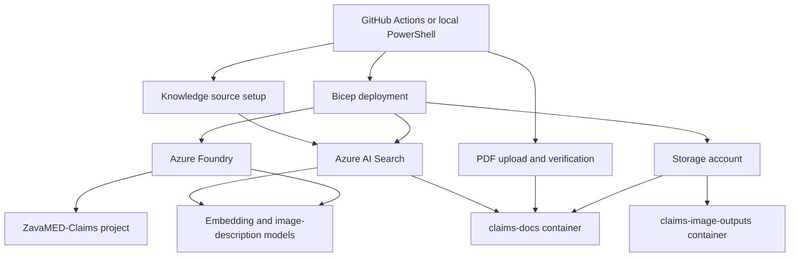

# Zava Azure AI Claims Search Demo

Deploy Azure AI Search with a blob knowledge source, Azure Foundry with a project and two model deployments, and storage for claims documents and image outputs. Bicep creates the infrastructure. PowerShell uploads the PDFs, verifies their contents, and configures the knowledge source.

## What gets deployed

| Component | Configuration |
| --- | --- |
| Azure AI Search | Standard, one replica, one partition |
| Azure Foundry | AIServices, S0 |
| Foundry project | `ZavaMED-Claims` |
| Embedding model | `text-embedding-3-large` |
| Image-description model | `gpt-5-mini` |
| Storage account | StorageV2, Standard ZRS, Hot tier |
| Blob container | `claims-docs`, with two PDFs |
| Image-output container | `claims-image-outputs`, private and initially empty |
| Blob knowledge source | Daily ingestion, minimal extraction, image verbalization enabled |

Resource names and region are set in [config/demo.json](config/demo.json). The included service names are examples; choose globally unique names before deployment. The default region is `eastus`.

## Architecture



The blob knowledge source generates its data source, index, indexer, and skillset in Search. It reads the documents, creates embeddings, and describes extracted images. Knowledge bases and application behavior are outside this package's scope.

The image-output container is provisioned separately. No image-export projection or asset-store binding is configured, so creating the knowledge source does not populate that container.

The demo uses public service endpoints, private blob containers, and HTTPS for storage access. Network security perimeters, private endpoints, and shared hub networking are outside this standalone package. Bicep grants Search permission to read storage and invoke the Foundry models. The deployment scripts update resources managed by this package and reject matching resources created outside it.

## Included documents

- [Appeal_Letter_Doe_John.pdf](data/claims-docs/Appeal_Letter_Doe_John.pdf)
- [Clinical_Guideline_AMH_RAD_2026.pdf](data/claims-docs/Clinical_Guideline_AMH_RAD_2026.pdf)

[data/manifest.json](data/manifest.json) records each file's size and SHA-256 hash. The upload script uses this manifest to upload and verify the two documents.

## Deploy

Follow the [deployment guide](docs/deployment.md) to select your Azure tenant, subscription, resource group, and resource names.

From PowerShell, sign in to Azure and run:

```powershell
./scripts/Deploy.ps1 -SubscriptionId '<subscription-id>' -ResourceGroupName '<resource-group>' -Mode WhatIf
./scripts/Deploy.ps1 -SubscriptionId '<subscription-id>' -ResourceGroupName '<resource-group>' -Mode Deploy
```

You can also use the manual **Deploy demo** GitHub Actions workflow. Pushes and pull requests run package validation automatically.

Search Standard, ZRS storage, and model usage incur Azure charges. Service and model availability, quota, and policy requirements depend on your subscription and region.

See [validation](docs/validation.md) for the package checks and deployment acceptance steps.
