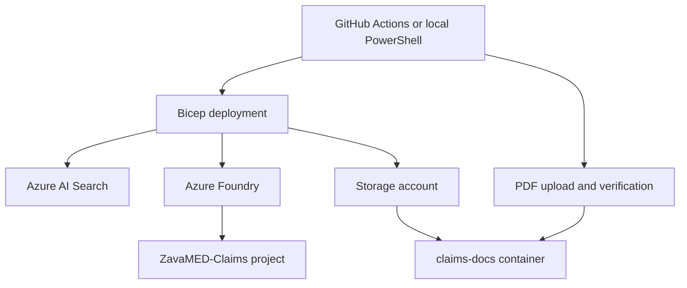

# Zava Azure AI Claims Search Demo

Deploy Azure AI Search, an Azure Foundry resource with a project, and a storage account containing two claims documents. Bicep creates the resources. PowerShell uploads the PDFs and verifies their contents.

## What gets deployed

| Component | Configuration |
| --- | --- |
| Azure AI Search | Standard, one replica, one partition |
| Azure Foundry | AIServices, S0 |
| Foundry project | `ZavaMED-Claims` |
| Storage account | StorageV2, Standard ZRS, Hot tier |
| Blob container | `claims-docs`, with two PDFs |

Resource names and region are set in [config/demo.json](config/demo.json). The included service names are examples; choose globally unique names before deployment. The default region is `eastus`.

## Architecture



The package provisions the services, project, container, and files. Search indexes, model deployments, and application behavior are outside its scope.

The demo uses public service endpoints, a private blob container, and HTTPS for storage access. The deployment scripts update resources managed by this package and reject matching resources created outside it.

## Included documents

- [Appeal_Letter_Doe_John.pdf](data/claims-docs/Appeal_Letter_Doe_John.pdf)
- [Clinical_Guideline_AMH_RAD_2026.pdf](data/claims-docs/Clinical_Guideline_AMH_RAD_2026.pdf)

[data/manifest.json](data/manifest.json) records each file's size and SHA-256 hash. The upload script uses this manifest to upload and verify the two documents.

## Deploy

Follow the [deployment guide](docs/deployment.md) to select your Azure tenant, subscription, resource group, and resource names.

From PowerShell, sign in to Azure and run:

```powershell
./scripts/Deploy.ps1 -SubscriptionId '<subscription-id>' -ResourceGroupName '<resource-group>' -Mode WhatIf
./scripts/Deploy.ps1 -SubscriptionId '<subscription-id>' -ResourceGroupName '<resource-group>' -Mode Deploy
```

You can also use the manual **Deploy demo** GitHub Actions workflow. Pushes and pull requests run package validation automatically.

Search Standard and ZRS storage incur Azure charges. Service availability and policy requirements depend on your subscription and region.

See [validation](docs/validation.md) for the package checks and deployment acceptance steps.
